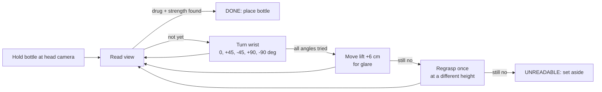

# T16: Read the pill bottle label at the head camera

## What this test does
With the bottle held up to the head camera, the robot reads the drug name and strength. If a view doesn't give
both, it tries the next step. It never guesses.

Each view: crop the bottle → turn it upright → flatten the curved label → Gemini (EasyOCR if Gemini is down).
What each view reads is combined, because the fingers hide a different part of the label at each angle.

Run: `ros2 run pill_bottle_nodes test_label --ros-args -p expected_drug:=FUNKITOL -p expected_strength:=200MG`
Conditions (5 trials each): label facing camera, facing away, under fingers, lying in claw, glare.

## Accepted results
- [ ] ≥ 80 % of trials read the correct drug name and strength
- [ ] **0 wrong reads.** "Unreadable" is acceptable; a wrong drug or strength is not.
- [ ] Still reads a front-facing label with Gemini off (EasyOCR)
- [ ] Wrist and lift are back at the verify pose before placing
- [ ] Offline tests pass: `python3 -m pytest test/`

## Possible issues
- **Curved label:** text near the edges is squeezed. Flattening helps, and wrist turns show the edges face-on.
- **Fingers over the label:** turning the wrist doesn't help because the fingers turn with the bottle; it needs the regrasp.
- **Label on the far side:** a narrow label facing straight away can't be seen with ±90° turns. 135° might work if
  the bottle clears the mast; check by hand.
- **Glare** off the plastic. Moving the lift changes the angle.
- **Gemini busy, no internet, or no key:** EasyOCR is weak on small or blurry text, so keep the bottle close.
- **Wrong box:** if another bottle is in view, it reads the biggest box (the one in the claw).
- **Regrasp drops the bottle:** reported as DROP.
- **numpy 2** getting pulled in by `pip install easyocr` breaks ROS. Check `numpy<2` after installing.
- **API key** must stay in `GEMINI_API_KEY` on the robot, never in the repo (it's public).
