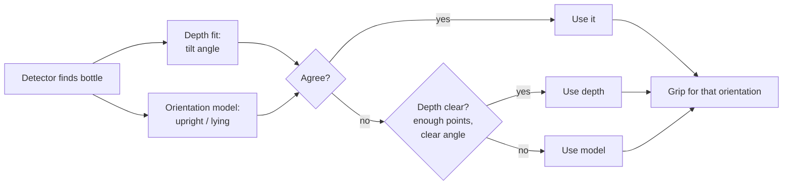

# T17: Orientation model (upright vs lying) and grip per orientation

## What this test does
A small YOLO classification model looks at the bottle crop and says **upright** or **lying**. Its answer is
combined with the existing depth-based orientation, and the grasp adjusts to the result.

| Orientation | Grip |
|---|---|
| Upright | Side grab, low on the bottle, deep in the claw (keeps the label visible) |
| Lying | Base turns so the bottle points along the arm; claw closes across it |
| Tilted | Grab at the bottle's center height |

Train: `orientation_classifier_colab.ipynb` (crop → click to sort → train → save `orientation_cls.pt`).
Run: `ros2 run pill_bottle_nodes test_orientation`. Place the bottle and type u / l / t; it compares depth,
model and combined.

## Accepted results
- [ ] Model validation accuracy ≥ 95 % in the notebook
- [ ] Combined orientation correct in ≥ 90 % of 20+ trials
- [ ] Combined is never worse than depth alone, and better on far or elevated bottles
- [ ] Lying bottles: grip HELD in 3 of 5 tries

## Possible issues
- **Not enough training pictures,** or all from one spot. Get 100+ per class: floor, table, shelf, different distances and lighting.
- **Near-duplicate pictures** make accuracy look too good. The notebook splits by time to avoid this.
- **Few depth points** (far away, shiny, elevated) make the depth fit noisy. That's where the model should win.
- **Lying bottle seen end-on** looks like a circle to both methods.
- **No wrist pitch** on Stretch 2, so tilted bottles can't be matched; it uses a center-height grab instead.
- **Model and depth disagree:** it's logged. Check the test_orientation numbers to see which to trust.
