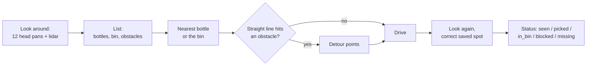

# T18: Remember bottles, bin and obstacles (object memory + obstacle integration test)

## What this test does
Instead of a full map, the robot keeps a list of what it has seen and where (meters from where it started):
bottles (with orientation), the bin (with rim height) and obstacles (lidar circles). Seeing the same thing again
(within 15 cm, 35 cm for the bin) updates it instead of adding a duplicate. The list is saved as JSON + a map picture.

Run: `ros2 run pill_bottle_nodes test_world`. Conditions: look around (finds them all, no duplicates), after driving
1 m out and back with two 180° turns (saved spots still within 10 cm), bottle behind an obstacle (detour, no
collision, saved spot within 10 cm), no way around (marked blocked, nothing moves).
Offline: `pytest test/test_world.py` runs the same mission code in a simulated room (drifting odometry, hidden
bottles, lidar), including 100 random rooms with zero collisions.

## Accepted results
- [ ] Finds and saves 3 bottles + the bin from one look-around, no duplicates, positions within 10 cm
- [ ] Saved spots still within 10 cm after driving 2 m and turning 180°
- [ ] Reaches a bottle behind 1 obstacle using a detour, zero collisions, 4 of 5 trials
- [ ] No way around → marks the bottle "blocked" and moves on
- [ ] Offline tests (simulated room) pass

## Possible issues
- Wheel slip makes saved spots drift; correct them on each approach
- Lidar only sees at its own height (low/overhanging things are missed)
- A bottle on a table can look like an obstacle to the lidar
- The bin may be marked as an obstacle; it must be allowed as a target
